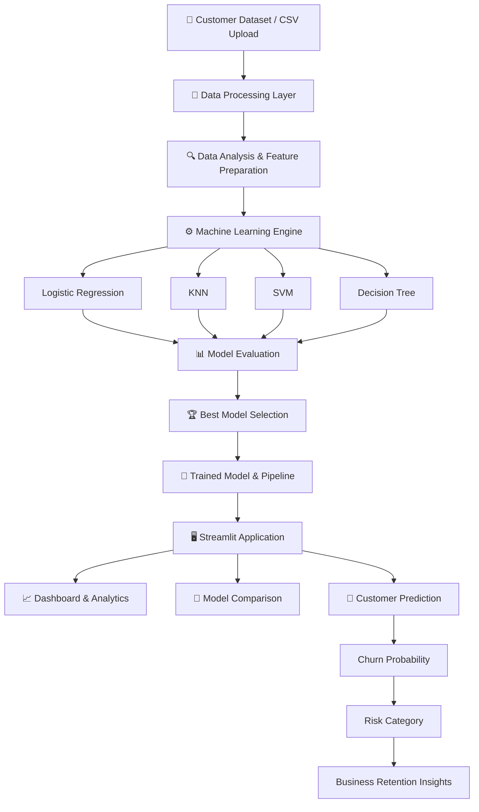
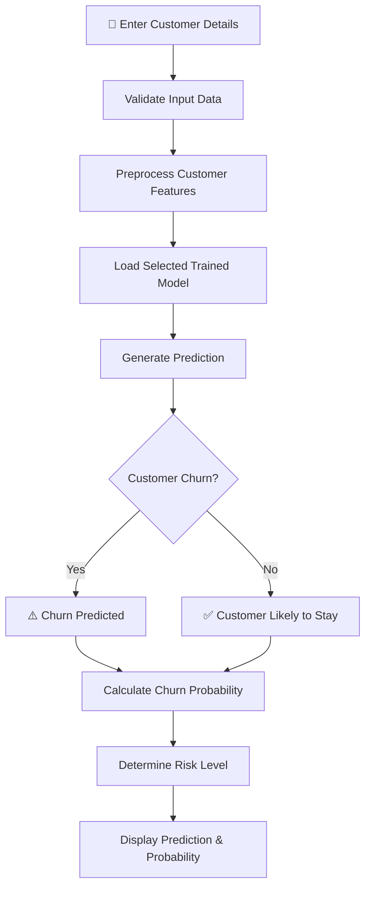

# 📊 Customer Churn Prediction Using Machine Learning

> **Predict customer churn. Understand customer behavior. Improve retention.**

A machine learning application designed to identify customers who are likely to discontinue a telecom service. By analyzing customer information, service usage, billing details, and subscription patterns, the system predicts churn probability and helps businesses identify customers who may need attention.

---

## 🚀 Overview

Customer churn is one of the major challenges faced by telecom and subscription-based businesses. Losing customers directly impacts revenue, growth, and long-term business performance. However, identifying customers who may leave before they actually discontinue their service can help businesses take preventive action.

This project uses machine learning classification algorithms to analyze customer data and predict whether a customer is likely to churn or remain with the service.

The application trains and compares multiple machine learning models, evaluates their performance using different metrics, and provides a simple interactive interface for exploring customer data and making individual predictions.

---

## 🎯 Project Objectives

- Identify customers who are likely to discontinue a service.
- Analyze customer behavior and subscription-related patterns.
- Implement and compare multiple classification algorithms.
- Evaluate model performance using suitable metrics.
- Predict churn probability for individual customers.
- Categorize customers according to their churn risk.
- Help businesses make data-driven customer retention decisions.

---

## ✨ Features

- **Customer Churn Prediction:** Predict whether a customer is likely to leave or continue using the service.
- **Multiple ML Algorithms:** Implement Logistic Regression, KNN, SVM, and Decision Tree.
- **Model Comparison:** Compare different models using evaluation metrics.
- **Customer Analytics Dashboard:** Visualize churn distribution and customer-related patterns.
- **Prediction Probability:** View the estimated probability of customer churn.
- **Risk Categorization:** Categorize customers into Low, Medium, and High risk.
- **Dataset Upload:** Upload CSV datasets for analysis, where supported.
- **Data Preprocessing:** Handle missing values, categorical variables, and numerical features.
- **Simple User Interface:** Interactive application built using Streamlit.

---

## 🧠 Machine Learning Algorithms

### 1. Logistic Regression
A classification algorithm used to estimate the probability of a customer belonging to the churn or non-churn class. It provides a simple and interpretable baseline model.

### 2. K-Nearest Neighbors (KNN)
Predicts customer churn by comparing a customer with similar records in the dataset. The classification depends on the nearest neighboring customers.

### 3. Support Vector Machine (SVM)
Finds an optimal decision boundary to separate churn and non-churn customers based on their features.

### 4. Decision Tree
Uses a sequence of decision rules based on customer attributes to classify whether a customer is likely to churn.

---

## 📈 Model Evaluation

The trained models are evaluated using the following performance metrics:

| Metric | Description |
|---|---|
| Accuracy | Measures the overall percentage of correct predictions. |
| Precision | Measures how many predicted churn customers are actually churn customers. |
| Recall | Measures how many actual churn customers were successfully identified. |
| F1-Score | Balances precision and recall. |
| ROC-AUC | Measures the model's ability to distinguish churn and non-churn customers. |
| Confusion Matrix | Displays correct and incorrect predictions across both classes. |

The models are compared using these metrics to identify the most suitable model for customer churn prediction. F1-score is particularly useful because customer churn datasets may contain imbalanced classes.

---

## 🔄 Machine Learning Workflow

The project follows a structured machine learning workflow:

1. Data collection and dataset loading
2. Exploratory data analysis
3. Data cleaning and preprocessing
4. Feature selection and transformation
5. Train-test splitting
6. Model training
7. Model evaluation
8. Model comparison and selection
9. Customer churn prediction
10. Risk interpretation and visualization

---

## 🏗️ System Architecture

The application is organized into different layers, from customer data input to prediction output.



---

## 🔬 Prediction Workflow

The prediction process begins with customer information entered through the application. The input data is processed using the same preprocessing steps used during model training. The trained model then generates a prediction and probability estimate.



---

## 📊 Risk Categorization

Customers are categorized based on their predicted churn probability.

| Churn Probability | Risk Category | Interpretation |
|---|---|---|
| Below 30% | 🟢 Low Risk | Customer is less likely to churn. |
| 30% to below 60% | 🟡 Medium Risk | Customer shows a moderate possibility of churn. |
| 60% and above | 🔴 High Risk | Customer may be more likely to discontinue the service. |

These risk levels are application-defined thresholds and do not represent guaranteed customer behavior.

---

## 📂 Dataset

The project is designed to work with the **IBM Telco Customer Churn Dataset**, which contains customer information related to demographics, services, contracts, billing, and churn status.

### Dataset features may include:

- Customer ID
- Gender
- Senior Citizen
- Partner
- Dependents
- Tenure
- Phone Service
- Internet Service
- Online Security
- Online Backup
- Device Protection
- Tech Support
- Streaming Services
- Contract Type
- Paperless Billing
- Payment Method
- Monthly Charges
- Total Charges
- Churn

### Target Variable

`Churn`

- `Yes` – Customer has churned.
- `No` – Customer has remained with the service.

Dataset source: [IBM Telco Customer Churn Dataset – Kaggle](https://www.kaggle.com/datasets/blastchar/telco-customer-churn)

---

## 🧹 Data Preprocessing

Data preprocessing is an important part of this project because raw customer data may contain missing values, categorical variables, and inconsistent data types.

The preprocessing pipeline may include:

- Handling missing values
- Removing duplicate records
- Converting numeric columns into suitable data types
- Separating target variable from input features
- Encoding categorical variables
- Scaling numerical features
- Splitting data into training and testing sets

Categorical and numerical data are processed separately to ensure that the machine learning models can use the data effectively.

---

## 🛠️ Technologies Used

| Technology | Purpose |
|---|---|
| Python | Core programming language |
| Pandas | Data processing and analysis |
| NumPy | Numerical operations |
| Scikit-learn | Machine learning and evaluation |
| Streamlit | Interactive application interface |
| Matplotlib | Data visualization |
| Seaborn | Statistical visualization |
| Joblib | Model persistence |

---

## 🖥️ Application Modules

### Dashboard
Provides an overview of customer information, churn distribution, and basic customer analytics through visualizations.

### Model Comparison
Displays performance metrics for Logistic Regression, KNN, SVM, and Decision Tree, helping users compare the trained models.

### Customer Prediction
Allows users to enter customer details and receive a predicted churn result, probability, and risk category.

### Dataset Information
Displays dataset details, column information, data preview, and dataset statistics. Supports uploading compatible CSV files if implemented in the application.

---

## 📁 Project Structure

```text
Customer-Churn-Prediction/
│
├── app.py
├── requirements.txt
├── README.md
│
├── data/
│   └── Telco-Customer-Churn.csv
│
├── models/
│   └── best_model.pkl
│
├── src/
│   ├── data_preprocessing.py
│   ├── train_models.py
│   ├── evaluate_models.py
│   └── predict.py
│
└── outputs/
    └── model_comparison.csv
```

*The exact folder structure may vary depending on the final implementation.*

---

## ⚙️ Installation & Setup

### 1. Clone the Repository

```bash
git clone https://github.com/YOUR-USERNAME/Customer-Churn-Prediction.git
```

### 2. Navigate to the Project Directory

```bash
cd Customer-Churn-Prediction
```

### 3. Create a Virtual Environment

```bash
python -m venv venv
```

### 4. Activate the Virtual Environment

**Windows:**

```bash
venv\Scripts\activate
```

### 5. Install Dependencies

```bash
pip install -r requirements.txt
```

### 6. Add the Dataset

Place the dataset CSV file inside the `data/` folder.

### 7. Run the Application

```bash
streamlit run app.py
```

The application will open in your default browser.

---

## 💡 Real-World Applications

Customer churn prediction can be applied to various subscription-based industries:

- Telecom companies
- Internet service providers
- Streaming platforms
- Banking and financial services
- SaaS businesses
- Subscription-based applications
- Online service providers

Businesses can use churn predictions to identify customers who may need additional support, personalized offers, service improvements, or retention campaigns.

---

## 🔮 Future Enhancements

- Implement advanced algorithms such as Random Forest, Gradient Boosting, and XGBoost.
- Improve model performance through hyperparameter tuning.
- Add feature importance and explainability using SHAP.
- Introduce personalized customer retention recommendations.
- Integrate real-time prediction APIs.
- Add customer segmentation using clustering.
- Develop automated model retraining.
- Deploy the application to a cloud platform.

---

## 🎓 Learning Outcomes

Through this project, I explored and implemented:

- Data preprocessing and exploratory data analysis
- Classification algorithms
- Feature encoding and scaling
- Training and testing machine learning models
- Model evaluation and comparison
- Prediction probability analysis
- Data visualization
- Streamlit application development
- Applying machine learning to a real-world business problem

---

## 👨‍💻 Project Information

**Project:** Customer Churn Prediction Using Machine Learning  
**Domain:** Machine Learning / Data Science  
**Language:** Python  
**Interface:** Streamlit  
**Algorithms:** Logistic Regression, KNN, SVM, Decision Tree

Developed as an academic and learning project focused on applying machine learning techniques to a practical customer-retention problem.

---

> *Turning customer data into meaningful predictions to help businesses make smarter retention decisions.*

